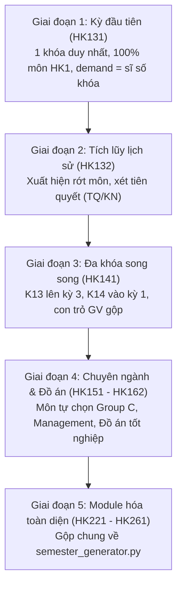
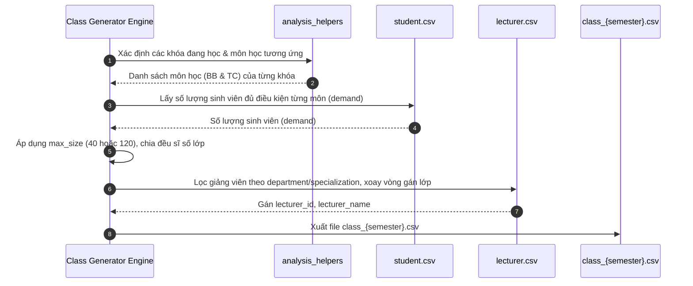

# Hướng Dẫn & Đặc Tả Kỹ Thuật: Cơ Chế Sinh Lớp Học Phần (Class Generator)

Tài liệu này tổng hợp phân tích toàn bộ logic tạo lớp học phần từ các script trong thư mục `synthetic_data/generators/classes/` (từ giai đoạn lịch sử **HK131** đến module hóa **HK261**), đồng thời cung cấp phương pháp luận và đặc tả chuyển đổi chi tiết để **áp dụng trọn vẹn cho hệ thống dữ liệu học vụ mới (Khóa K20 – K26)**.

---

## 1. Bản Chất và Triết Lý Thiết Kế Lớp Học

Trong hệ thống mô phỏng học vụ đại học (đặc thù theo quy chế tín chỉ của Trường ĐH Bách Khoa - ĐHQG-HCM), lớp học phần **không bao giờ được tạo cố định hay ngẫu nhiên**, mà bắt buộc phải sinh ra dựa trên **Nhu cầu đăng ký thực tế (Actual Student Demand)**:

1. **Phản ánh đúng giai đoạn đào tạo:**
   - Năm 1: Lớp đại cương Toán, Vật lý, Nhập môn điện toán, Ngoại ngữ.
   - Năm 2 – 3: Lớp cơ sở ngành, bắt buộc ngành, tự chọn Quản lý kỹ thuật.
   - Năm 3 – 4: Lớp chuyên ngành sâu (AI, SE, Security...), Đồ án liên ngành/tích hợp.
   - Năm 4 (Kỳ 7–8): Thực tập ngoài trường, Đồ án chuyên ngành, Đồ án tốt nghiệp / Khóa luận.
   - Giai đoạn gia hạn (Kỳ 9–12): Các lớp trả nợ môn rớt, học cải thiện điểm.
2. **Tuân thủ quy chế tiên quyết & chuẩn đầu ra:**
   - Chỉ mở lớp khi sinh viên đã tích lũy môn học trước/khởi nguyên (`KN`) hoặc đạt môn tiên quyết (`TQ`).
   - Mở lớp Đồ án tốt nghiệp / Khóa luận chỉ khi sinh viên thỏa chuẩn tiếng Anh và ngày Công tác Xã hội (CTXH).
3. **Quy mô và sĩ số tối ưu theo từng loại môn:**
   - **Môn thường (Toán, KHTN, Cơ sở & Chuyên ngành):** Sĩ số chuẩn $\approx 40$ sinh viên/lớp.
   - **Môn Lý luận Chính trị & Pháp luật:** Sĩ số giảng đường lớn $\approx 120$ sinh viên/lớp.
4. **Phân bổ giảng viên cân bằng tải (Load Balancing):**
   - Phân công đúng Khoa / Bộ môn (`department`) và đúng chuyên môn (`specialization`).
   - Dùng thuật toán xoay vòng con trỏ (Round-Robin) đảm bảo mỗi giảng viên dạy đều đặn **3 – 5 lớp / học kỳ**, không bị lệch tải.

---

## 2. Phân Tích Logic Tạo Lớp Qua Từng Giai Đoạn Lịch Sử

Các file script hiện có trong thư mục này đại diện cho 5 giai đoạn tiến hóa của pipeline sinh lớp:



### 2.1. Giai đoạn 1: Kỳ 1 của khóa đầu tiên (`generate_class_hk131.py`)
- **Đặc trưng:** Hệ thống mới khởi động, chỉ có **duy nhất 1 khóa sinh viên** (khóa K13).
- **Cách xác định môn học:** Lấy toàn bộ 5 môn bắt buộc của học kỳ 1 (`MT1003`, `PH1003`, `CO1005`, `LA1003`, `CO1023`).
- **Nhu cầu đăng ký (`demand`):**
  - Môn thường: $\text{demand} = \text{Tổng sinh viên khóa}$.
  - Riêng môn Anh văn 1 (`LA1003`): Trừ đi các sinh viên đã có chứng chỉ miễn học tiếng Anh.
- **Thuật toán chia lớp (`balanced_class_sizes`):**
  $$\text{class\_count} = \left\lceil \frac{\text{demand}}{\text{max\_size}} \right\rceil$$
  $$\text{base\_size}, \text{remainder} = \text{divmod}(\text{demand}, \text{class\_count})$$
  - Các lớp có chỉ số `< remainder` nhận $\text{base\_size} + 1$, các lớp còn lại nhận $\text{base\_size}$.
  - *Ví dụ:* 1.621 sinh viên chia cho lớp 40 SV $\rightarrow$ 41 lớp: 22 lớp 40 SV và 19 lớp 39 SV. Tuyệt đối không có lớp bị lẻ 1–2 SV!
- **Gán giảng viên:** Tạo con trỏ `dept_pointers[dept]`, xoay vòng danh sách giảng viên của từng khoa/bộ môn.

### 2.2. Giai đoạn 2: Tích lũy lịch sử & Trả nợ môn (`generate_class_hk132.py`)
- **Đặc trưng:** Sinh viên học sang kỳ 2, bắt đầu có kết quả học tập từ kỳ 1 (`load_history("hk131")`).
- **Phát sinh môn rớt:** Sinh viên rớt môn ở HK1 sẽ phải đăng ký học lại song song với môn mới của HK2 nếu thỏa tiên quyết.
- **Nhu cầu thực tế:** Gọi hàm `calculate_eligibility_for_schedule` duyệt từng sinh viên:
  - Ưu tiên 1: Đăng ký trả nợ môn rớt.
  - Ưu tiên 2: Đăng ký môn mới kỳ 2 nếu đã đạt điều kiện tiên quyết (`TQ`/`KN`).
  - Không vượt quá trần 22 tín chỉ/kỳ.
- **Mở lớp:** Môn nào có $\text{demand} > 0$ thì mới mở lớp.

### 2.3. Giai đoạn 3: Đa khóa cùng học song song (`generate_class_hk141.py`)
- **Đặc trưng:** Khóa K14 mới nhập học (vào học kỳ 1), trong khi khóa K13 bước vào học kỳ 3.
- **Gộp danh sách môn:**
  $$\text{COURSE\_ORDER} = \text{K13\_COURSES (HK3)} + \text{K14\_COURSES (HK1)} + \text{Môn trả nợ}$$
- **Cân bằng tải giảng viên:** Con trỏ `dept_pointers` chạy liên tục qua toàn bộ các môn của tất cả các khóa, đảm bảo giảng viên dạy môn năm 1 hay năm 2 đều được chia lớp đồng đều.

### 2.4. Giai đoạn 4: Chuyên ngành, Đồ án & Tự chọn (`generate_class_hk161.py`)
- **Đặc trưng:** Khóa K13 bước vào năm 4 (HK7), K14 vào năm 3 (HK5), K15 vào năm 2 (HK3), K16 vào năm 1 (HK1).
- **Môn tự chọn theo mùa (Seasonality):**
  - **Học kỳ Thu (kỳ lẻ: HKxx1):** Mở tự chọn chuyên ngành Group C kỳ lẻ, tự chọn Quản lý kỹ thuật HK6, tự do HK7.
  - **Học kỳ Xuân (kỳ chẵn: HKxx2):** Mở tự chọn chuyên ngành Group C kỳ chẵn, tự chọn Quản lý kỹ thuật HK4, tự do HK8.
- **Điều kiện mở lớp Đồ án tốt nghiệp / Khóa luận:** Sinh viên phải tích lũy đủ số tín chỉ quy định, qua chuẩn tiếng Anh và hoàn thành $\ge 12$ ngày CTXH.

### 2.5. Giai đoạn 5: Module hóa toàn diện (`semester_generator.py`)
- **Đặc trưng:** Thay vì viết script rời rạc cho từng kỳ, toàn bộ logic được gom vào một hàm duy nhất `generate_class(semester_code)`.
- Các file `generate_class_hk221.py` đến `generate_class_hk261.py` chỉ còn vỏn vẹn 4 dòng gọi hàm.

---

## 3. Bản Đồ Chuyển Đổi Sang Hệ Thống Dữ Liệu Mới (K20 – K26)

Dưới đây là bảng đối chiếu chuyển đổi chi tiết từ hệ thống cũ sang hệ thống mới:

| Thành phần | Hệ thống cũ (Legacy K13–K16) | Hệ thống mới chuẩn hóa (K20–K26) | Ghi chú chuyển đổi |
|---|---|---|---|
| **Chương trình đào tạo (CTĐT)** | Đọc từ `curriculum_computer_science.csv` cũ | Đọc từ `curriculums.csv` & `program_structures.csv` qua hàm `get_curriculum_for_cohort_semester(cohort, term)` | Chuẩn ABET 128 tín chỉ, có phân biệt môn BB và nhóm TC (A, B, C, D). |
| **Môn tiên quyết** | File cũ `course_prerequisite.csv` | File mới `course_prerequisites.csv` | Chuẩn hóa rõ 3 quan hệ: `TQ` (tiên quyết), `KN` (học trước), `SH` (song hành). |
| **Hồ sơ sinh viên** | `student_profiles.csv` (1.500 SV K13) | `student.csv` (11.092 SV từ K20 đến K26) | Lọc khóa theo 2 chữ số đầu của `user_id` (VD: `20xxxx` $\rightarrow$ K20, `24xxxx` $\rightarrow$ K24). |
| **Danh sách giảng viên** | `lecturer_for_class.csv` cũ | `lecturer.csv` mới (100 GV chuẩn) | Có sẵn cột `department` và `specialization` khớp 100% với `courses.csv`. |
| **Sĩ số lớp tối đa (`max_size`)** | Mặc định cứng 120 cho mọi môn | **Môn thường = 40 SV**<br>**Môn Chính trị = 120 SV** | Đúng thực tế giảng đường Bách Khoa. |
| **Phân công giảng viên** | Chỉ theo `department` chung | Theo cả `department` và `specialization` | Môn AI do GV AI dạy, môn SE do GV SE dạy; môn cơ sở chung do mọi GV CSE dạy. |

---

## 4. Đặc Tả Thuật Toán Sinh Lớp Học Phần Mới

### 4.1. Cấu trúc bảng đầu ra `class_{semester}.csv`
Mỗi file lớp học được xuất ra tại thư mục `synthetic_data/generated/classes/` với định dạng UTF-8 with BOM (`utf-8-sig`):

```csv
class_id,course_code,course_name,semester,class_group,max_capacity,lecturer_id,lecturer_name,department
HK241_MT1003_L01,MT1003,Giải tích 1,HK241,L01,40,GV00056,Nguyễn Hoàng Hùng,Khoa Khoa học Ứng dụng - Bộ môn Toán ứng dụng
HK241_MT1003_L02,MT1003,Giải tích 1,HK241,L02,40,GV00057,Hồ Khánh Phúc,Khoa Khoa học Ứng dụng - Bộ môn Toán ứng dụng
HK241_SP1031_L01,SP1031,Triết học Mác - Lênin,HK241,L01,120,GV00085,Võ Quang Hà,Khoa Khoa học Ứng dụng - Bộ môn Lý luận Chính trị
```

### 4.2. Quy trình 4 bước sinh lớp cho một học kỳ bất kỳ



#### Bước 1: Xác định các khóa học và môn học cần mở trong kỳ
Với một mã học kỳ `semester` (ví dụ `HK241`):
1. Tính kỳ học tương đối $\text{term}$ của từng khóa $C \in [20, 26]$:
   $$\text{term} = (\text{năm} - C) \times 2 + \text{kỳ}$$
2. Nếu $1 \le \text{term} \le 8$: Khóa đang trong tiến độ chuẩn.
   - Gọi `get_curriculum_for_cohort_semester(f"K{C}", term)` để lấy danh sách các môn bắt buộc (`BB`) và nhóm môn tự chọn (`TC`).
3. Nếu $9 \le \text{term} \le 12$: Khóa đang trong giai đoạn trễ hạn (học trả nợ / gia hạn ĐATN).

#### Bước 2: Phân hệ đào tạo & Tính toán nhu cầu (`demand`) từng môn học
Trong hệ thống BKU, sinh viên được phân vào 3 hệ đào tạo độc lập. **Lớp học phần của hệ nào chỉ dành riêng cho sinh viên hệ đó**:
- **Đại trà (`standard`):** Mã nhóm lớp có tiền tố **`L`** (ví dụ: `L01`, `L02`, ...).
- **Chất lượng cao (`high-quality`):** Mã nhóm lớp có tiền tố **`CC`** (ví dụ: `CC01`, `CC02`, ...).
- **Tiên tiến (`advanced`):** Mã nhóm lớp có tiền tố **`TT`** (ví dụ: `TT01`, `TT02`, ...).

**Nhu cầu mở lớp (`demand`):**
- Tính toán riêng biệt cho từng hệ: $\text{demand}_{(\text{môn}, \text{hệ})} = \text{Số SV của hệ đăng ký môn đó}$.
- Riêng `LA1003`: Trừ số lượng sinh viên đạt chuẩn miễn Anh văn trong từng hệ (Đại trà: ~25%, CLC: ~35%, Tiên tiến: ~50%).

#### Bước 3: Chia lớp và phân bổ sĩ số theo từng hệ (`balanced_class_sizes`)
Với mỗi môn học và mỗi hệ đào tạo:
- Xác định sức chứa tối đa:
  $$\text{max\_size} = \begin{cases} 120 & \text{nếu môn thuộc Khối Lý luận Chính trị (mã SP)} \\ 40 & \text{cho các môn học còn lại} \end{cases}$$
- Số lớp cần mở cho hệ: $\text{class\_count} = \lceil \text{demand} / \text{max\_size} \rceil$.
- Ký hiệu nhóm lớp: `{PREFIX}{idx:02d}` (Ví dụ: Đại trà: `L01`..`L23`, CLC: `CC01`..`CC12`, Tiên tiến: `TT01`..`TT05`).
- Mã lớp học phần: `{semester}_{course_code}_{class_group}` (Ví dụ: `HK201_MT1003_L01`, `HK201_MT1003_CC01`, `HK201_MT1003_TT01`).

#### Bước 4: Phân công giảng viên cân bằng tải
1. Lấy danh sách giảng viên đủ điều kiện dạy môn học dựa theo `department` và `specialization` (sử dụng logic trong `get_lecturers_by_course`).
2. Sử dụng con trỏ xoay vòng hoặc thuật toán Greedy chọn giảng viên có số lớp đã gán trong kỳ ít nhất:
   $$\text{lecturer} = \arg\min_{gv \in \text{eligible\_lecturers}} (\text{assigned\_classes}[gv])$$
3. Gán giảng viên vào lớp và tăng $\text{assigned\_classes}[gv] \leftarrow \text{assigned\_classes}[gv] + 1$.

---

## 5. Hướng Dẫn Triển Khai Code Mẫu Cho Dữ Liệu Mới

Dưới đây là đoạn code chuẩn hóa mẫu có thể dùng để sinh lớp cho bất kỳ học kỳ nào trong hệ thống mới:

```python
import math
import csv
from pathlib import Path
from collections import defaultdict
import pandas as pd

# 1. Khai báo đường dẫn
ROOT_DIR = Path(__file__).resolve().parents[2]
ACADEMICS_DIR = ROOT_DIR / "generated" / "academics"
USERS_DIR = ROOT_DIR / "generated" / "users"
OUTPUT_DIR = ROOT_DIR / "generated" / "classes"

import sys
sys.path.insert(0, str(ROOT_DIR / "analysis"))
from analysis_helpers import get_curriculum_for_cohort_semester, get_lecturers_by_course

def generate_classes_for_semester(semester_code: str):
    """Sinh toàn bộ các lớp học phần cho một học kỳ bất kỳ (K20 - K26)."""
    semester_code = semester_code.upper()
    acad_year = int(semester_code[2:4])
    term_idx = int(semester_code[4])
    
    # Nạp danh sách sinh viên & giảng viên
    students = pd.read_csv(USERS_DIR / "student.csv", encoding="utf-8-sig")
    lecturers = pd.read_csv(USERS_DIR / "lecturer.csv", encoding="utf-8-sig")
    
    # Lưu vết số lớp đã gán của từng giảng viên trong kỳ
    assigned_count = defaultdict(int)
    
    # 1. Xác định các khóa đang học trong kỳ này
    course_demands = defaultdict(int)
    for cohort_num in range(20, acad_year + 1):
        rel_term = (acad_year - cohort_num) * 2 + term_idx
        if not (1 <= rel_term <= 8):
            continue
            
        cohort_str = f"K{cohort_num}"
        cohort_sv_count = len(students[students["user_id"].astype(str).str.startswith(str(cohort_num))])
        
        # Lấy CTĐT của khóa ở kỳ này
        cur_data = get_curriculum_for_cohort_semester(cohort_str, rel_term)
        for c in cur_data["compulsory_courses"]:
            code = c["course_code"]
            course_demands[code] += cohort_sv_count

    # 2. Sinh các lớp học phần và gán giảng viên
    classes = []
    for course_code, demand in course_demands.items():
        if demand <= 0:
            continue
            
        # Quy định sĩ số
        is_politics = course_code.startswith("SP")
        max_cap = 120 if is_politics else 40
        num_classes = math.ceil(demand / max_cap)
        
        # Lấy danh sách GV dạy được môn này
        eligible_info = get_lecturers_by_course(course_code)
        eligible_gvs = eligible_info["eligible_lecturers"]
        
        for idx in range(1, num_classes + 1):
            group_code = f"L{idx:02d}"
            
            # Chọn giảng viên có số lớp ít nhất hiện tại (Greedy Load Balancing)
            best_gv = min(eligible_gvs, key=lambda g: assigned_count[g["user_id"]])
            assigned_count[best_gv["user_id"]] += 1
            
            classes.append({
                "class_id": f"{semester_code}_{course_code}_{group_code}",
                "course_code": course_code,
                "course_name": eligible_info["course_name_vi"],
                "semester": semester_code,
                "class_group": group_code,
                "max_capacity": max_cap,
                "lecturer_id": best_gv["user_id"],
                "lecturer_name": best_gv["name"],
                "department": eligible_info["department"],
            })
            
    # 3. Xuất file CSV
    OUTPUT_DIR.mkdir(parents=True, exist_ok=True)
    out_file = OUTPUT_DIR / f"class_{semester_code.lower()}.csv"
    pd.DataFrame(classes).to_csv(out_file, index=False, encoding="utf-8-sig")
    print(f"Đã tạo thành công {out_file.name} với {len(classes)} lớp học phần.")

if __name__ == "__main__":
    # Ví dụ sinh lớp cho học kỳ HK241:
    generate_classes_for_semester("HK241")
```

---

## 6. Tổng Kết

1. **Kế thừa:** Giữ nguyên triết lý chia đều sĩ số (`balanced_class_sizes`), quy tắc đặt mã lớp (`class_id`), và cơ chế xoay vòng con trỏ giảng viên.
2. **Cải tiến:** Tách biệt sĩ số 40 SV (môn thường) và 120 SV (môn chính trị); dùng trực tiếp bộ bảng `academics/` mới (K20–K26) và `lecturer.csv` mới (đã có `department` & `specialization`).
3. **Hiệu quả:** Mỗi học kỳ sinh ra khoảng **200 – 600 lớp học phần** tùy theo số lượng khóa học đồng thời, tải giảng dạy của 100 giảng viên luôn giữ đều đặn **3 – 5 lớp / học kỳ**.
