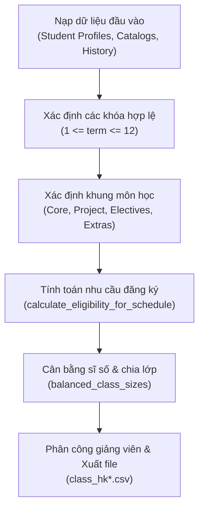

# Quy tắc và Cơ chế Tạo Lớp Học (Class Generator)

Thư mục này chứa các script chịu trách nhiệm mở các lớp học phần (`class_hk*.csv`) cho từng học kỳ trong toàn bộ vòng đời mô phỏng dữ liệu học vụ (từ **HK131** đến **HK261+**).

---

## 1. Mục đích và Nguyên tắc Thiết kế
Lớp học **không được tạo ngẫu nhiên hoặc cố định danh sách từ trước**, mà được sinh ra dựa trên **nhu cầu đăng ký học thực tế (Actual Demand)** của toàn bộ sinh viên còn đang theo học tại thời điểm đó:
1. **Phản ánh đúng tiến độ từng khóa:** Khóa mới (năm 1) học môn đại cương; khóa năm 3 học chuyên ngành & đồ án môn học; khóa năm 4 làm khóa luận / đồ án tốt nghiệp; khóa trễ hạn học trả nợ môn.
2. **Tuân thủ chặt chẽ quy chế đào tạo:** Môn học chỉ được sinh viên đăng ký nếu thỏa điều kiện tiên quyết (`TQ`), chuẩn tiếng Anh, chuẩn ngày Công tác Xã hội (CTXH), và không vượt trần **22 tín chỉ/học kỳ**.
3. **Mở lớp theo quy mô tối ưu:** Số lớp mở tương ứng với số lượng sinh viên đủ điều kiện, chia đều sĩ số, tránh lớp quá đông (>120 SV) hoặc quá ít (<40 SV khi nhu cầu lớn).
4. **Phân công giảng viên đúng chuyên môn:** Giảng viên được phân công giảng dạy dựa theo bộ môn quản lý môn học đó (`get_department`).

---

## 2. Quy trình Sinh Lớp Học (Pipeline)

Mỗi học kỳ, quá trình tạo lớp diễn ra theo 6 bước tuần tự:



### Bước 1: Nạp dữ liệu đầu vào
- **Hồ sơ sinh viên:** `synthetic_data/generated/student_profile/student_profiles.csv` (chứa năng lực học tập, tiếng Anh, ngày CTXH, tình trạng thôi học tự nguyện).
- **Danh mục môn học & Giảng viên:** `course.csv`, `course_prerequisite.csv`, `lecturer_for_class.csv`, `assessment.csv`.
- **Lịch sử học tập các kỳ trước:** `load_history(("hk131", ..., "hk{prev}"))` chứa toàn bộ kết quả Pass/Fail của sinh viên ở các kỳ quá khứ.

### Bước 2: Xác định các khóa sinh viên hợp lệ
Số học kỳ đã trải qua của từng khóa tính theo công thức:
$$\text{term} = \text{semester\_index}(\text{semester}) - \text{semester\_index}(\text{HK}\{\text{cohort}\}1) + 1$$
- **$\text{term} < 1$:** Khóa chưa nhập học $\rightarrow$ Bỏ qua.
- **$1 \le \text{term} \le 12$:** Sinh viên trong khung thời gian đào tạo hợp lệ $\rightarrow$ Được xét mở lớp.
- **$\text{term} > 12$:** Quá thời gian đào tạo tối đa (6 năm / 12 kỳ) $\rightarrow$ Đã bị buộc thôi học, không được mở lớp.

### Bước 3: Phân bổ khung môn học theo giai đoạn
Tùy theo số kỳ sinh viên đã theo học (`term`), môn học được chỉ định như sau:

| Học kỳ sinh viên (`term`) | Vai trò / Tiến độ | Môn học cốt lõi | Môn tự chọn & Đồ án |
| :--- | :--- | :--- | :--- |
| **Kỳ 1 – 5** | Đại cương & Cơ sở | Khung chuẩn `HK1` $\rightarrow$ `HK5` | Môn phụ (`additional_courses`) lấp đầy tín chỉ |
| **Kỳ 6** | Chuyên ngành năm 3 | `SP1039`, `CO2001`, `CO3005`, `CO3335` | Đồ án liên ngành (`CO3107/CO3109/CO3111`) + Quản lý (`3 TC`) |
| **Kỳ 7** | Chuyên ngành năm 4 | `SP1037`, `CO4029` (Đồ án CN) | Tự do (`FREE: 3 TC`), Nhóm C (`GROUP_C: 6 TC`) |
| **Kỳ 8** | Tốt nghiệp chuẩn | `SP1007`, `CO4337` (Khóa luận/ĐATN) | Nhóm C (`GROUP_C: 9 TC`), Quản lý (`MANAGEMENT: 3 TC`) |
| **Kỳ 9 – 12** | Trễ hạn (Late) | Trả nợ môn rớt, `CO4029`, `CO4337` | Trả nợ tự chọn: `FREE: 9 TC`, `GROUP_C: 15 TC`, `MANAGEMENT: 3 TC` |

#### Quy tắc Môn Tự chọn theo Mùa:
- **Kỳ Thu (Học kỳ 1 - kỳ lẻ: HKxx1):** Mở môn tự chọn kỳ lẻ: `MANAGEMENT HK6`, `FREE HK7`, `GROUP_C HK7`.
- **Kỳ Xuân (Học kỳ 2 - kỳ chẵn: HKxx2):** Mở môn tự chọn kỳ chẵn: `MANAGEMENT HK4`, `FREE HK8`, `GROUP_C HK8`.

### Bước 4: Xét điều kiện sinh viên (`calculate_eligibility_for_schedule`)
Thuật toán lọc và xếp môn cho từng sinh viên:
1. **Kiểm tra trạng thái học vụ:**
   - Đã thôi học tự nguyện (`voluntary_dropout_semester`) $\rightarrow$ Bỏ qua.
   - Bị buộc thôi học quá hạn 12 kỳ hoặc nợ điểm (`is_academic_dismissal`) $\rightarrow$ Không được học.
   - Bị đình chỉ 1 kỳ do 2 kỳ liên tiếp nợ quá nhiều tín chỉ (`is_academic_suspension_semester`) $\rightarrow$ Tạm dừng 1 kỳ.
2. **Thứ tự ưu tiên đăng ký môn:**
   - **Ưu tiên 1:** Trả nợ môn đã rớt (`failed_courses`).
   - **Ưu tiên 2:** Môn theo khung chương trình của khóa nếu thỏa môn tiên quyết (`TQ`).
   - **Ưu tiên 3:** Môn tự chọn theo chỉ tiêu tín chỉ (`credit_targets`).
   - **Ưu tiên 4:** Môn phụ lấp đầy định mức học phí (15 tín chỉ) cho sinh viên khá giỏi học vượt.
   - **Điều kiện làm ĐATN / Khóa luận (`CO4029`, `CO4337`):** Phải đạt chuẩn tiếng Anh (`is_english_passed`) và hoàn thành tối thiểu **12 ngày CTXH**.
   - **Giới hạn trần:** Tổng tín chỉ đăng ký không vượt quá `MAX_CREDITS = 22`.

### Bước 5: Cân bằng sĩ số và mở lớp
Với mỗi môn học có sinh viên đăng ký ($\text{demand} > 0$):
- Gọi hàm `balanced_class_sizes(demand)`:
  - Nếu $\text{demand} < 40$: Mở 1 lớp.
  - Nếu $\text{demand} \ge 40$: Chia thành $k$ lớp sao cho sĩ số các lớp xấp xỉ nhau, không lớp nào vượt quá **120 sinh viên**, và hạn chế lớp dưới 40 sinh viên.
- Đặt tên nhóm lớp: `L01`, `L02`, `L03`,...
- Định dạng mã lớp: `{SEMESTER}_{course_code}_{group}` (Ví dụ: `HK261_CO4029_L01`).

### Bước 6: Phân công giảng viên cân bằng (`assign_balanced_lecturers`)
- Lấy danh sách giảng viên theo từng khoa/bộ môn phụ trách (`get_department(course_code)`: `ChuyenNganh`, `DaiCuong`, `Triet`).
- Duy trì một con trỏ luân phiên toàn cục (`pointer`) cho từng khoa/bộ môn xuyên suốt toàn bộ các môn học và phân lớp trong học kỳ:
  $$\text{lecturer\_id} = \text{dept\_lecturers}[\text{pointer} \pmod{\text{total\_dept\_lecturers}}]$$
  $$\text{pointer} = \text{pointer} + 1$$
- Cơ chế này đảm bảo:
  - Khối lượng giảng dạy được phân bổ đều cho tất cả giảng viên trong khoa (trung bình 1–3 lớp/kỳ).
  - Không có tình trạng dồn 50–70 lớp vào giảng viên đầu tiên danh sách trong khi phần lớn giảng viên khác không được phân công lớp nào.
- Xuất dữ liệu ra file `synthetic_data/generated/classes/class_{semester}.csv`.

---

## 3. Cấu trúc Tệp Đầu ra (`class_hk*.csv`)

File đầu ra có định dạng CSV UTF-8 with BOM (`utf-8-sig`) gồm 7 cột chuẩn:

| Cột | Kiểu dữ liệu | Ý nghĩa | Ví dụ |
| :--- | :--- | :--- | :--- |
| `class_id` | String | Mã định danh duy nhất của lớp học phần | `HK261_CO1005_L01` |
| `course_code` | String | Mã môn học | `CO1005` |
| `course_name` | String | Tên môn học tiếng Việt | `Nhập môn Điện toán` |
| `semester` | String | Mã học kỳ | `HK261` |
| `class_group` | String | Ký hiệu nhóm lớp | `L01` |
| `lecturer_id` | String | Mã giảng viên phụ trách | `GV042` |
| `lecturer_name`| String | Họ và tên giảng viên | `Nguyễn Văn A` |

---

## 4. Danh sách các File Script Generator

Thư mục này gồm 2 nhóm file:

1. **Nhóm Script độc lập lịch sử (HK131 $\rightarrow$ HK212):**
   - Các file `generate_class_hk131.py` đến `generate_class_hk212.py`.
   - Được viết độc lập qua từng giai đoạn phát triển dự án.
   - Đã được chuẩn hóa bổ sung khóa K21 tại HK211 và HK212.

2. **Nhóm Script chuẩn hóa module hóa (HK221 $\rightarrow$ HK261+):**
   - Các file `generate_class_hk221.py` đến `generate_class_hk261.py`.
   - Cấu trúc cực kỳ gọn nhẹ (chỉ ~10 dòng), gọi trực tiếp hàm xử lý trung tâm:
     ```python
     from semester_generator import generate_class

     if __name__ == "__main__":
         generate_class("HK261")
     ```
   - Sử dụng chung logic chuẩn tại `synthetic_data/generators/semester_generator.py`.

---

## 5. Hướng dẫn Thực thi
Để sinh lớp học cho một học kỳ, luôn đảm bảo kích hoạt virtual environment và chạy theo thứ tự:

```bash
# Ví dụ sinh lớp cho học kỳ HK261:
.venv/bin/python3 synthetic_data/generators/classes/generate_class_hk261.py
```

> **LƯU Ý:** File lớp học (`class_hk*.csv`) phải được tạo **TRƯỚC** khi chạy file đăng ký học (`enrollment_hk*.csv`) của cùng học kỳ đó.
