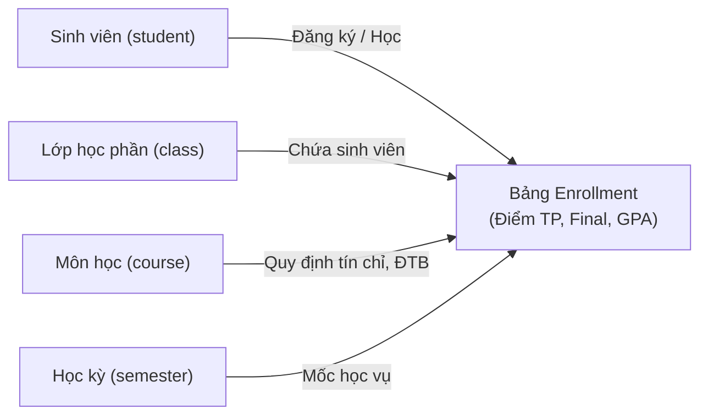
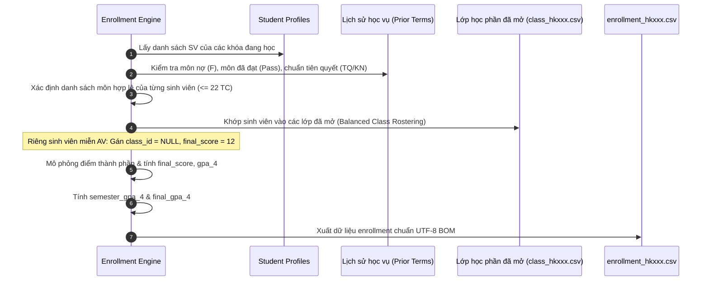

# Hướng Dẫn & Đặc Tả Kỹ Thuật: Cơ Chế Sinh Bảng Điểm & Đăng Ký Học Phần (Enrollment Generator)

Tài liệu này tổng hợp phân tích toàn bộ nguyên lý học vụ, cấu trúc điểm số, thuật toán xếp lớp và công thức tính điểm trung bình (GPA) từ hệ thống mô phỏng học vụ đại học (đặc thù theo quy chế tín chỉ của Trường Đại học Bách Khoa - ĐHQG-HCM), đồng thời cung cấp phương pháp luận và đặc tả chi tiết áp dụng cho **hệ thống dữ liệu học vụ mới (Khóa K20 – K26)**.

---

## 1. Bản Chất và Triết Lý Của Bảng `Enrollment`

Trong kiến trúc cơ sở dữ liệu học vụ, bảng **`enrollment`** (Đăng ký học phần & Kết quả học tập) là bảng trung tâm kết nối giữa:
- **Sinh viên (`student`)**: Người tham gia học tập.
- **Lớp học phần (`class`)**: Phiên bản lớp cụ thể mở trong học kỳ có giảng viên phụ trách, thời khóa biểu và phòng học.
- **Môn học (`course`)**: Học phần trong chương trình đào tạo với số tín chỉ và cơ cấu đánh giá xác định.
- **Học kỳ (`semester`)**: Mốc thời gian diễn ra học phần.

Bảng `enrollment` phục vụ 3 mục tiêu cốt lõi:
1. **Lưu vết đăng ký lớp học phần:** Xác định sinh viên nào học lớp nào, với giảng viên nào trong học kỳ.
2. **Ghi nhận chi tiết kết quả học tập:** Lưu trữ từ điểm các thành phần bài tập lớn, thí nghiệm/thực hành, kiểm tra giữa kỳ, thi cuối kỳ cho đến điểm tổng kết, điểm chữ và điểm thang 4.
3. **Cập nhật tiến độ học vụ:** Tính toán điểm trung bình học kỳ (`semester_gpa_4`), điểm trung bình tích lũy (`final_gpa_4`), tổng tín chỉ tích lũy, và ghi nhận môn rớt để bắt buộc học lại trong các kỳ kế tiếp.

---

## 2. Quy Tắc Học Vụ Đặc Biệt: Miễn Tiếng Anh (English Exemption - Điểm 12)

Đây là quy định đặc thù và cực kỳ quan trọng của **Trường Đại học Bách Khoa - ĐHQG-HCM** cần được mô phỏng chuẩn xác 100%:

### 2.1. Bản chất quy chế BKU
- Sinh viên có chứng chỉ quốc tế (IELTS, TOEFL, TOEIC, VSTEP) đạt chuẩn hoặc vượt qua kỳ thi kiểm tra năng lực đầu khóa (Placement Test) sẽ được **miễn học** một số hoặc toàn bộ các học phần Anh văn trong chương trình:
  - `LA1003` - Anh văn 1 (2 TC)
  - `LA1005` - Anh văn 2 (2 TC)
  - `LA1007` - Anh văn 3 (2 TC)
  - `LA1009` - Anh văn 4 (2 TC)
- Khi được miễn, sinh viên **không cần đến lớp**, không cần thi bất kỳ bài kiểm tra nào và **không chiếm chỗ trong sĩ số của lớp học phần**.
- **Quy tắc phân loại theo hệ đào tạo:**
  * **Chất lượng cao (`high-quality`) và Tiên tiến (`advanced`):** Chuẩn đầu vào yêu cầu năng lực tiếng Anh quốc tế, do đó **được miễn trọn gói toàn bộ 4 học phần Tiếng Anh** (`LA1003`, `LA1005`, `LA1007`, `LA1009`). Ngay tại học kỳ đầu tiên (`HK201`), 100% sinh viên CLC và Tiên tiến đều có 4 bản ghi enrollment điểm `12` cho cả 4 môn này.
  * **Đại trà (`standard`):** Xét miễn theo kết quả kiểm tra xếp lớp (Placement Test) hoặc nộp chứng chỉ đầu khóa (khoảng ~25% sinh viên được miễn `LA1003` ở HK1). Những sinh viên chưa miễn sẽ học và thi bình thường.

### 2.2. Minh chứng thực tế từ Cổng MyBK (Bảng điểm tiến độ)
Trên bảng điểm tiến độ học tập chính thức của Trường Đại học Bách Khoa:
- Sinh viên học Anh văn 1 (`LA1003`) đạt điểm **8.3** (Điểm chữ: **B+**, Tích lũy: **2 TC**, Tình trạng: $\checkmark$).
- Sinh viên được miễn Anh văn 2 (`LA1005`), Anh văn 3 (`LA1007`), Anh văn 4 (`LA1009`):
  - Cột điểm hệ 10 ghi nhận mã số đặc biệt: **`12`**.
  - Cột điểm chữ: **`--`** (hoặc `NULL`).
  - Cột điểm thang 4: **`NULL`**.
  - Cột tín chỉ tích lũy: Vẫn được tính đủ **`2 TC`** và đánh dấu $\checkmark$ (Đạt chuẩn hoàn thành môn).

### 2.3. Quy tắc mô phỏng trong bảng `enrollment`
Đối với các bản ghi được miễn tiếng Anh:
| Cột dữ liệu | Giá trị quy định | Giải thích chi tiết |
|---|---|---|
| `class_id` | `NULL` (hoặc chuỗi rỗng `""`) | **Không tạo lớp học phần**, không phân giảng viên, không tiêu tốn tài nguyên phòng học/sĩ số. |
| `course_id` | Mã môn (`LA1003`, `LA1005`, v.v.) | Vẫn lưu để ghi nhận sinh viên đã đăng ký công nhận tín chỉ môn này. |
| `quiz, lab, btl, giua_ky, cuoi_ky` | `NULL` | Không có bài kiểm tra thành phần. |
| `final_score` | **`12.0`** | Mã quy ước chuyển điểm/miễn môn nội bộ của ĐH Bách Khoa. |
| `letter_grade` | `NULL` (hoặc `""`) | Không có điểm chữ (trên MyBK hiển thị `--`). |
| `gpa_4` | `NULL` | Không quy đổi sang điểm thang 4. |
| `passed` | `True` | Đạt môn, sinh viên không phải học lại môn này. |
| `status` | `'Exempted'` (hoặc `'Pass'`) | Trạng thái ghi nhận miễn học phần. |
| **Ảnh hưởng GPA** | **KHÔNG TÍNH VÀO GPA** | Điểm 12 tuyệt đối **không** được nhân vào tổng điểm để tính `semester_gpa_4` và `final_gpa_4`. |
| **Ảnh hưởng Tín chỉ** | **CỘNG VÀO TÍN CHỈ TÍCH LŨY** | Số tín chỉ của môn được cộng đủ vào tổng tín chỉ tích lũy để xét tốt nghiệp. |

---

## 3. Cấu Trúc Điểm Thành Phần & Mô Phỏng Điểm Số

### 3.1. Cấu trúc đánh giá môn học (Course Assessment Schema)
Mỗi môn học có đề cương chi tiết quy định tỷ lệ phần trăm giữa các bài đánh giá, tổng trọng số luôn bằng $100\%$ ($1.0$):
- **`quiz`** (Kiểm tra ngắn / Quiz trên LMS BKeL)
- **`lab`** (Thí nghiệm / Thực hành xưởng / Lab)
- **`btl`** (Bài tập lớn / Đồ án môn học / Project)
- **`giua_ky`** (Thi giữa kỳ - Tự luận hoặc Trắc nghiệm)
- **`cuoi_ky`** (Thi cuối kỳ tập trung)

*Ví dụ:*
- Môn `CO1005` (Nhập môn Điện toán): `quiz`: 10%, `lab`: 20%, `btl`: 20%, `cuoi_ky`: 50%.
- Môn `MT1003` (Giải tích 1): `btl`: 20%, `giua_ky`: 30%, `cuoi_ky`: 50%.

### 3.2. Mô hình sinh điểm số dựa trên đặc trưng sinh viên (Latent Profile Simulation)
Điểm số không được sinh ngẫu nhiên đồng đều, mà phản ánh đúng năng lực và thói quen của từng sinh viên:
1. **Năng lực nền tảng (`base_score` $\in [3.0, 9.5]$):** Xác định dựa trên điểm chuẩn đầu vào và phân loại học lực (`academic_level`).
2. **Độ lệch môn học:**
   - Môn Toán/Lý: Ảnh hưởng bởi `math_level` của sinh viên và độ khó môn (`difficulty`).
   - Môn Chuyên ngành: Ảnh hưởng bởi `discipline` (sự chăm chỉ) và `motivation` (động lực học tập).
3. **Kỳ vọng điểm môn học ($\mu$):**
   $$\mu = \text{clip}\left(\text{base\_score} - \text{difficulty\_penalty} + \text{retake\_bonus}, 2.0, 9.8\right)$$
   - $\text{retake\_bonus} = +2.0$ nếu sinh viên học lại môn này (bao gồm trả nợ môn F hoặc đăng ký học lại cải thiện điểm D/D+ để đạt chuẩn tốt nghiệp $\text{GPA}_4 \ge 2.0$).
4. **Điểm thành phần ($S_{\text{comp}}$):**
   Được lấy mẫu ngẫu nhiên từ phân phối chuẩn với tâm là $\mu$ và độ lệch chuẩn $\sigma$ (mô phỏng sự trồi sụt phong độ thi cử):
   $$S_{\text{comp}} = \text{round}\left(\text{clip}\left(\mathcal{N}(\mu, \sigma^2), 0.0, 10.0\right), 1\right)$$
5. **Điểm tổng kết hệ 10 (`final_score`):**
   $$\text{final\_score} = \text{round}\left(\sum_{k} S_{\text{comp}, k} \times W_k, 1\right)$$

### 3.3. Thang quy đổi Điểm Chữ & Thang 4 (Quy chế tín chỉ BKU)

$$\begin{array}{|c|c|c|c|l|}
\hline
\textbf{Điểm hệ 10 (final\_score)} & \textbf{Điểm chữ} & \textbf{Thang 4 (gpa\_4)} & \textbf{Passed} & \textbf{Xếp loại / Trạng thái} \\
\hline
\ge 8.5 & \text{A} & 4.0 & \text{True} & \text{Xuất sắc / Giỏi} \\
8.0 - 8.4 & \text{B+} & 3.5 & \text{True} & \text{Khá giỏi} \\
7.0 - 7.9 & \text{B} & 3.0 & \text{True} & \text{Khá} \\
6.5 - 6.9 & \text{C+} & 2.5 & \text{True} & \text{Trung bình khá} \\
5.5 - 6.4 & \text{C} & 2.0 & \text{True} & \text{Trung bình} \\
5.0 - 5.4 & \text{D+} & 1.5 & \text{True} & \text{Trung bình yếu} \\
4.0 - 4.9 & \text{D} & 1.0 & \text{True} & \text{Yếu (Đạt)} \\
< 4.0 & \text{F} & 0.0 & \text{False} & \textbf{Không đạt (Rớt môn, phải học lại)} \\
\hline
\text{Miễn (12.0)} & \text{NULL / --} & \text{NULL} & \text{True} & \textbf{Miễn học phần (Exempted)} \\
\hline
\end{array}$$

---

## 4. Công Thức Tính Điểm Trung Bình (GPA Calculation)

### 4.1. Điểm trung bình học kỳ (`semester_gpa_4`)
Là điểm trung bình có trọng số theo số tín chỉ của tất cả các môn sinh viên đăng ký học trong học kỳ đó:

$$\text{semester\_gpa\_4} = \frac{\sum_{i \in \text{Học kỳ}} \left(\text{gpa\_4}_i \times \text{credits}_i\right)}{\sum_{i \in \text{Học kỳ}} \text{credits}_i}$$

> [!IMPORTANT]
> **Loại trừ môn miễn:** Chỉ tính cho các môn có điểm số thực tế. Các môn có `final_score == 12` (hoặc `gpa_4` là `NULL`) **không được tính** vào cả tử số (điểm tích lũy) lẫn mẫu số (tổng tín chỉ tính GPA) của học kỳ.

### 4.2. Điểm trung bình tích lũy (`final_gpa_4` / CPA)
Phản ánh điểm trung bình tích lũy của toàn bộ quá trình học tập tính đến hết học kỳ hiện tại:

$$\text{final\_gpa\_4} = \frac{\sum_{j \in \text{Môn đạt duy nhất}} \left(\text{max\_gpa\_4}_j \times \text{credits}_j\right)}{\sum_{j \in \text{Môn đạt duy nhất}} \text{credits}_j}$$

**Nguyên tắc cốt lõi theo quy chế tín chỉ ĐH Bách Khoa:**
1. **Lấy điểm cao nhất:** Nếu sinh viên học lại một môn nhiều lần (để cải thiện điểm hoặc sau khi rớt môn F), hệ số điểm thang 4 cao nhất đạt được sẽ được dùng để tính điểm tích lũy.
2. **Không tính điểm rớt (F) vào CPA tích lũy:** Điểm F chỉ ảnh hưởng tiêu cực đến GPA của chính học kỳ bị rớt. Khi xét CPA tích lũy tổng kết, điểm F không tính vào tín chỉ tích lũy (khi sinh viên học lại qua môn thì điểm môn đạt sẽ thay thế).
3. **Loại trừ môn điểm 12:** Môn miễn không có điểm thang 4 nên không tham gia vào phép tính CPA.

### 4.3. Xử lý GPA đối với Học kỳ đang hoạt động (`is_active = True` - Kỳ hiện tại `HK261`)
Trong học kỳ hiện tại (`HK261` - cờ `is_active = True` trong `semester.csv` hoặc `is_semester_active(semester) == True`):
- Do học kỳ vẫn đang diễn ra và chưa chốt sổ học vụ, các cột **`semester_gpa_4`** và **`final_gpa_4`** được gán giá trị trống (`NaN` / `NULL`).
- Điểm thành phần và kết quả môn học vẫn được mô phỏng bình thường để phục vụ theo dõi học vụ theo thời gian thực.
- Khi bước sang học kỳ mới và kỳ hiện tại chuyển trạng thái thành `is_active = False`, hệ thống mới tiến hành chốt GPA học kỳ và cập nhật CPA tích lũy.

---

## 5. Quy Trình & Thuật Toán Phân Bổ Sinh Viên Vào Lớp (Rostering Algorithm)

Trong mỗi học kỳ, quy trình sinh bảng enrollment diễn ra theo 5 bước tuần tự:

### Chi tiết các bước thực hiện:
1. **Xác định nhu cầu đăng ký từng sinh viên:**
   - **Sinh viên năm 1 (HK1):** Mặc định đăng ký toàn bộ 5 môn của HK1.
     - Kiểm tra nếu sinh viên được miễn Anh văn 1 (`LA1003`): Đưa vào danh sách hưởng điểm 12, **không xếp vào lớp học phần `LA1003`**.
   - **Sinh viên từ HK2 trở đi:**
     - **Ưu tiên 1 (Trả nợ môn & Cải thiện điểm):**
       * *Trả nợ môn rớt:* Bắt buộc đăng ký lại các môn đã thi rớt (`passed == False`) nếu học kỳ này có mở lớp (`retaken = True`).
       * *Cải thiện điểm (`retake_improvement_helper.py`):* Ở các học kỳ muộn (Kỳ 7, 8 hoặc giai đoạn kéo dài Kỳ 9–12), nếu sinh viên có GPA 4 tích lũy dự kiến $< 2.0$, hệ thống tự động cho phép sinh viên đăng ký học lại 1–2 môn đã đạt nhưng điểm thấp nhất (D: 1.0, D+: 1.5) với `retaken = True`. Lần học sau được cộng `retake_bonus = +2.0` nhằm giúp sinh viên kéo GPA tích lũy $\ge 2.0$ để tốt nghiệp hợp lệ.
     - **Ưu tiên 2 (Môn mới theo tiến độ):** Đăng ký các môn mới của học kỳ khuyến nghị nếu đã thỏa mãn toàn bộ điều kiện tiên quyết (`TQ`) hoặc học trước (`KN`) từ các kỳ trước. Đối với sinh viên lộ trình 3.5 năm (tốt nghiệp sớm), học kỳ HK7 sẽ đăng ký cả môn tự chọn của Kỳ 7 và Kỳ 8 để hoàn thành đủ 128 tín chỉ.
     - **Ràng buộc:** Tổng số tín chỉ đăng ký không vượt quá trần $22$ tín chỉ/kỳ.
2. **Phân bổ vào danh sách lớp theo đúng hệ đào tạo (`allocate_course_rosters`):**
   - **Phân tách tuyệt đối theo hệ (`program`):**
     * Sinh viên Đại trà (`standard`): Chỉ được xếp vào các lớp có mã nhóm bắt đầu bằng **`L`** (ví dụ: `HK201_MT1003_L01`..`L23`).
     * Sinh viên Chất lượng cao (`high-quality`): Chỉ được xếp vào các lớp có mã nhóm bắt đầu bằng **`CC`** (ví dụ: `HK201_MT1003_CC01`..`CC12`).
     * Sinh viên Tiên tiến (`advanced`): Chỉ được xếp vào các lớp có mã nhóm bắt đầu bằng **`TT`** (ví dụ: `HK201_MT1003_TT01`..`TT05`).
   - Phân bổ đều sinh viên của từng hệ vào các lớp học phần tương ứng để đảm bảo sĩ số các lớp tương đương nhau (khoảng 32–39 SV/lớp thường, 110–120 SV/lớp chính trị).
3. **Sinh điểm số thành phần & Xếp loại:**
   - Dùng mã băm ổn định `stable_seed = hash(f"{student_id}:{course_id}:{semester}")` làm seed cho bộ tạo số ngẫu nhiên.
   - Tính điểm thành phần, điểm tổng kết `final_score`, điểm chữ và `gpa_4`.
4. **Cập nhật GPA học kỳ và GPA tích lũy:**
   - Ghép nối dữ liệu học kỳ hiện tại với lịch sử các kỳ trước để tính toán `semester_gpa_4` và `final_gpa_4` nhất quán.

---

## 6. Đặc Tả Cấu Trúc Bảng Đầu Ra `enrollment_{semester}.csv`

File kết quả được lưu tại `synthetic_data/generated/enrollments/enrollment_{semester}.csv` với mã hóa UTF-8 có BOM (`utf-8-sig`):

| Tên cột | Kiểu dữ liệu | Bắt buộc | Ví dụ mẫu | Diễn giải |
|---|---|---|---|---|
| `enrollment_id` | Integer | Có | `1`, `2` | Khóa chính tăng dần duy nhất của bản ghi đăng ký |
| `student_id` | String / Int | Có | `2012345` | Mã số sinh viên (MSSV) |
| `class_id` | String | Không | `HK201_MT1003_L01` | Mã lớp học phần (`NULL` nếu miễn tiếng Anh) |
| `course_id` | String | Có | `MT1003`, `LA1003` | Mã học phần trong chương trình đào tạo |
| `semester` | String / Int | Có | `HK201` | Mã học kỳ |
| `retaken` | Boolean | Có | `False`, `True` | `True` nếu là lần học lại / cải thiện điểm |
| `quiz` | Float | Không | `8.5` | Điểm bài tập / kiểm tra ngắn LMS (làm tròn 1 chữ số) |
| `lab` | Float | Không | `9.0` | Điểm thí nghiệm / thực hành xưởng |
| `btl` | Float | Không | `8.0` | Điểm bài tập lớn / đồ án môn học |
| `giua_ky` | Float | Không | `7.5` | Điểm thi giữa kỳ |
| `cuoi_ky` | Float | Không | `8.0` | Điểm thi kết thúc học phần |
| `final_score` | Float | Có | `8.1` hoặc `12.0` | Điểm tổng kết hệ 10 (hoặc `12.0` nếu được miễn) |
| `letter_grade` | String | Không | `B+`, `A`, `F` | Điểm chữ quy đổi (`NULL` nếu miễn) |
| `gpa_4` | Float | Không | `3.5`, `4.0`, `0.0` | Điểm quy đổi hệ 4 (`NULL` nếu miễn) |
| `passed` | Boolean | Có | `True`, `False` | `True` nếu qua môn (hoặc miễn), `False` nếu rớt môn (F) |
| `semester_gpa_4` | Float | Không | `3.25` | Điểm trung bình học kỳ hệ 4 của sinh viên |
| `final_gpa_4` | Float | Không | `3.25` | Điểm trung bình tích lũy hệ 4 của sinh viên |
| `status` | String | Có | `Pass`, `Fail`, `Exempted` | Trạng thái hoàn thành học phần |

---

## 7. Lộ Trình Áp Dụng Cho Pipeline Mới (K20 – K26)

Để sinh dữ liệu `enrollment` cho hệ thống dữ liệu mới (bắt đầu từ `HK201` trở đi):
1. **Nguồn dữ liệu sinh viên:** Đọc từ `synthetic_data/generated/users/student.csv`.
2. **Nguồn cấu trúc môn & điểm:** Đọc danh mục môn học và tín chỉ từ `synthetic_data/generated/academics/courses.csv`, tỷ lệ điểm thành phần từ `synthetic_data/generated/academics/assessment.csv`.
3. **Nguồn lớp học phần:** Đọc các lớp đã mở từ `synthetic_data/generated/classes/class_{semester}.csv`.
4. **Xử lý tiếng Anh đầu vào:** Áp dụng hàm phân loại chứng chỉ đầu vào cho từng sinh viên để xác định các môn được miễn điểm `12.0` ngay từ `HK201`.
5. **Ghi nhận lịch sử luân chuyển:** Kết quả của `enrollment_{semester}.csv` được tích lũy vào kho dữ liệu lịch sử để phục vụ tính điều kiện tiên quyết và tính CPA cho các kỳ kế tiếp (`HK202`, `HK211`, v.v.).

